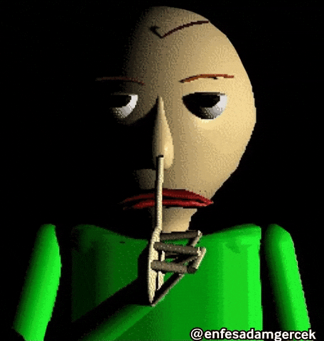
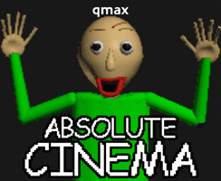
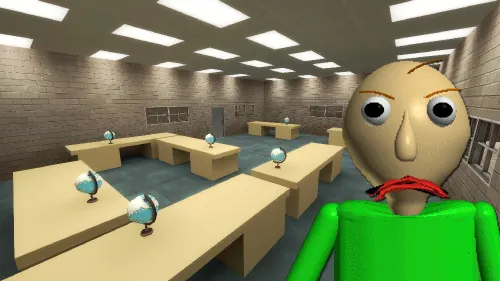
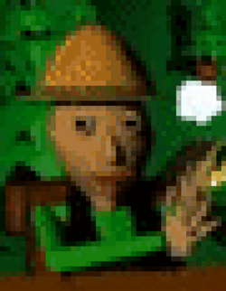

 

---

## 👨‍💻 Sobre mim

- 🎓 Estudante e desenvolvedor em formação
- 💻 Aprendendo novas tecnologias e desenvolvendo projetos
- 🚀 Interessado em desenvolvimento web e back-end
- 📼 Curioso pelo universo do terror analógico e criação de histórias
- 🧠 Construindo meu futuro na tecnologia, um projeto de cada vez!

Não esqueça dos seus projetos... não reclame!

---

## 🛠️ Tecnologias e ferramentas

---

## 📖 Atualmente estudando

- JavaScript
- Desenvolvimento web e back-end

---

## 🌟 Projetos em destaque

<table>
<tr>
<td width="50%" valign="top">

<h3 align="center">📚 Exercícios 2DS</h3>

Atividades e exercícios de Desenvolvimento de Sistemas, incluindo o projeto Mapa de Notas.

</td>
<td width="50%" valign="top">

<h3 align="center">🎮 ALONE, BUT...</h3>

Uma experiência de terror em desenvolvimento. Um complexo de salas e corredores onde a tranquilidade começa a se transformar em algo estranho.

</td>
</tr>
<tr>
<td colspan="2" valign="top">

<h3>🌐 Projetos Web</h3>

Experimentos com interfaces, aplicações, autenticação, banco de dados e desenvolvimento web.

</td>
</tr>
</table>

---

## 📊 Estatísticas do GitHub

<h3>Linguagens mais usadas</h3>

---

## 🐍 Snake de contribuições

---

## 💻 Ambiente de desenvolvimento

---

## 📚 Easter eggs do Baldi's Basics

 

Você encontrou um caderno misterioso... será que deveria abri-lo?

<b>📓 Abrir caderno secreto (1/7)</b>

 

### 🏫 BOLETIM ESCOLAR — BALDI'S BASICS

| Disciplina | Resultado |
|:---|:---:|
| Matemática | 0/7 cadernos |
| Programação | Em andamento |
| JavaScript | Estudando |
| Bugs encontrados | Infinitos |
| Bugs resolvidos | Alguns... |

**⚠️ ATENÇÃO, ALUNO!**

Não esqueça de fazer sua lição de casa!

Baldi está de olho nos seus commits...

 

---

## 💌 Meu cantinho especial

Um espaço especial por aqui é para ela 🤍

---

## 🎬 Rodapé animado

### Obrigado pela visita!

 

  

Feito por Eryckgk • 2026

